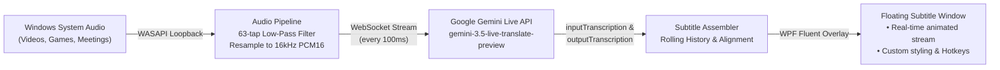
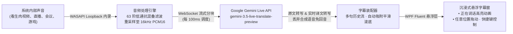

<div align="center">

# GeminiLiveSubtitles

**A lightweight, native, low-latency real-time AI subtitle translation desktop application for Windows.**

Powered by Google's **`gemini-3.5-live-translate-preview`** multimodal Live API. Directly captures system audio playback via Windows WASAPI Loopback and displays smooth, floating bilingual subtitles on top of your screen.

[English](#english) · [简体中文](#简体中文)

[](LICENSE)
[](https://github.com/OldWood-u/GeminiLiveSubtitles)
[](https://dotnet.microsoft.com/download/dotnet/9.0)
[](https://ai.google.dev/)
[](https://github.com/OldWood-u/GeminiLiveSubtitles/releases)

</div>

---

<a name="english"></a>
## English

### Overview

**GeminiLiveSubtitles** is designed for watching untranslated foreign videos, live streams, video conferences, podcasts, and games without language barriers. It captures the sound currently playing on your Windows system internally, streams it to Google Gemini's low-latency speech-to-speech translation model (`gemini-3.5-live-translate-preview`), and displays synchronized original and translated subtitles on a modern transparent overlay.



### Key Features

- **Native System Loopback Capture**: Captures internal Windows audio playback in WASAPI shared mode using `NAudio`. Automatically recovers when default playback devices change (e.g., plugging or unplugging headphones).
- **Sub-Second Streaming Translation**: Processes 44.1kHz/48kHz multi-channel audio through an anti-aliasing low-pass filter and linear resampler down to 16kHz mono PCM16. Audio chunks are dispatched every 100ms, with energy-based silence suppression to minimize latency and token usage.
- **Bilingual Real-Time Subtitles**: Simultaneously streams original speech recognition (`inputTranscription`) and model translation (`outputTranscription`). Discards synthesized TTS audio chunks to prevent feedback loops and save CPU cycles.
- **Rolling Conversation History**: Completed sentences automatically roll upwards with smooth transition animations while active speech updates in real time at the bottom. History sentences stay readable with customizable opacity (`HistoryOpacity`).
- **Immersive Floating Window**:
  - Consistent translucent background that remains stable without flickering or collapsing when silent.
  - Borderless, topmost, no-activate (won't steal keyboard focus or interrupt full-screen games/media), and hidden from `Alt+Tab`.
  - Full-window left-click dragging; 8-directional edge and corner resize grips.
  - Hover-only mini toolbar in the top-right corner; rich right-click context menu directly on the subtitle box.
  - Optional **Click-Through Mode** (`Alt+T`) for gaming or distraction-free work.
- **Deep Personalization**:
  - Swap order: **Translation Top / Original Bottom** or **Original Top / Translation Bottom**.
  - Alignment: Left-aligned or Centered text.
  - Modes: Bilingual, Translation-Only, or Original-Only.
  - Custom font family, font sizes, text colors, background color, background opacity, and text drop shadow.
  - Native Windows Fluent dark and light mode adaptation (`ThemeMode="System"`).
- **Multi-Language UI (i18n)**: Supports English, Simplified Chinese (简体中文), and Auto-detection based on system UI culture.
- **Global Hotkeys**:
  - `Alt+S`: Start / Pause translation
  - `Alt+H`: Show / Hide subtitle window
  - `Alt+T`: Toggle click-through mode
  - `Alt+C`: Clear subtitle history
  - *All shortcuts can be remapped in Settings.*
- **Security & Reliability**: API key is encrypted using Windows DPAPI (`DataProtectionScope.CurrentUser`) stored in `%AppData%\GeminiLiveSubtitles\settings.json`. Supports automatic reconnection with exponential backoff, session resumption, context window compression, and HTTP/SOCKS5 proxy configuration.

### Getting Started

#### Prerequisites
- Windows 10 (1809+) or Windows 11 (x64)
- [.NET 9.0 Desktop Runtime](https://dotnet.microsoft.com/download/dotnet/9.0)
- A Gemini API Key from [Google AI Studio](https://aistudio.google.com/)

#### Download & Run
1. Go to [Releases](https://github.com/OldWood-u/GeminiLiveSubtitles/releases) and download the latest `GeminiLiveSubtitles-v1.0.0-win-x64.zip` (or `GeminiLiveSubtitles.exe`).
2. Extract and launch `GeminiLiveSubtitles.exe`.
3. On first launch, the Settings window opens automatically. Paste your Gemini API Key and click **Save**.
4. Play any audio or video on your PC, and enjoy real-time translation!

---

<a name="简体中文"></a>
## 简体中文

### 软件简介

**GeminiLiveSubtitles** 是一款专为 Windows 平台打造的轻量、原生、低延迟 AI 实时字幕翻译软件。利用 Google **`gemini-3.5-live-translate-preview`** 模型的多模态实时语音能力，直接抓取 Windows 电脑内部正在播放的声音（视频、直播、会议、广播、游戏等），并在屏幕悬浮窗中提供流畅、同步的双语字幕。



### 核心特性

- **原生系统音频内录**：基于 `NAudio.Wasapi`（WASAPI 共享模式 Loopback），直接抓取默认播放设备的声音，音频输出设备发生改变（如插入或拔出耳机）后自动无感重连。
- **超低延迟流式处理**：内置 63 阶 Blackman 窗抗混叠低通滤波器与线性重采样器，将系统音频（48kHz / 44.1kHz 多声道）高效实时转换为 16kHz 单声道 PCM16，每 100ms 推送一次；静音段自动抑制以节约流量与 Token。
- **双语实时字幕**：同时接收 Gemini Live API 的原文转写（`inputAudioTranscription`）与译文转写（`outputAudioTranscription`），丢弃合成语音流以消除回声与额外 CPU 开销。
- **瀑布流对话历史**：说完的句子自动保留在上方，新句子在底部实时追加并平滑向上推挤；上方历史句子的不透明度（`HistoryOpacity`）可在设置中自由调节；支持滚轮回看历史、一键复制全部历史和清空历史。
- **沉浸式交互悬浮窗**：
  - 半透明圆角背景始终铺满窗口，无声或停顿时也保持舒适的视觉面积，绝不闪烁。
  - 无边框、全屏置顶、不抢焦点（`WS_EX_NOACTIVATE`，打游戏/看电影不切窗）、不在 Alt+Tab 中出现。
  - 窗口任意位置均可按住左键拖动；支持四周与四角 8 方向直接拉伸调整大小。
  - 平时纯净无干扰，仅在**鼠标悬停**时显示右上角药丸按钮栏；**在字幕上直接右键**即可弹出完整配置菜单。
  - 支持快捷键一键开启**鼠标穿透模式**（`Alt+T`）。
- **多语言本地化 (i18n)**：全界面支持简体中文与 English，可自动跟随系统或在设置中手动切换。
- **个性化视觉定制**：
  - 支持切换「**译文在上 · 原文在下**」或「**原文在上 · 译文在下**」。
  - 支持切换「**居中对齐**」或「**靠左对齐**」。
  - 支持切换「双语 / 仅译文 / 仅原文」、自定义字体、原/译文字号、颜色、背景色及不透明度、文字抗背景干扰阴影描边。
  - 原生支持 Windows **深色 / 浅色模式**（.NET 9 WPF `ThemeMode="System"`）。
- **全局快捷键**（支持在设置中直接按下组合键自定义）：
  - `Alt+S`：开始 / 暂停翻译
  - `Alt+H`：显示 / 隐藏字幕窗口
  - `Alt+T`：切换鼠标穿透模式
  - `Alt+C`：清空字幕历史
- **安全与稳定性**：API Key 使用 Windows DPAPI（`CurrentUser` 硬件加密）保存在本地，杜绝明文泄露风险；支持 Session Resumption（会话恢复）、上下文压缩与指数退避断线重连；支持 HTTP / SOCKS5 代理。

---

### 全局快捷键一览 / Keyboard Shortcuts

| 快捷键 / Hotkey | 功能 / Function (Chinese) | Description (English) |
| :--- | :--- | :--- |
| **`Alt + S`** | 开始 / 暂停实时翻译 | Start / Pause real-time translation |
| **`Alt + H`** | 显示 / 隐藏字幕窗口 | Show / Hide floating subtitle overlay |
| **`Alt + T`** | 切换鼠标穿透模式 | Toggle click-through mode |
| **`Alt + C`** | 清空字幕历史 | Clear subtitle history |

---

### 技术架构 / Technology Stack

- **Framework**: .NET 9.0 (C# 13, Windows Presentation Foundation)
- **Audio Capture**: `NAudio.Wasapi` (WASAPI Loopback Capture, Shared Mode)
- **Audio DSP**: Low-pass filtering (63-tap Blackman FIR), multi-channel downmixing, Linear resampler (16kHz PCM16 mono)
- **Cloud Model**: Google Gemini Live API (`gemini-3.5-live-translate-preview`) via WebSocket
- **UI Architecture**: MVVM with `CommunityToolkit.Mvvm`, XAML Fluent Theme (`ThemeMode="System"`), CompositionTarget smooth physics scrolling
- **Security**: Windows Data Protection API (DPAPI, `System.Security.Cryptography.ProtectedData`)

---

### 本地构建 / Build from Source

```powershell
# 1. 克隆仓库 / Clone repository
git clone https://github.com/OldWood-u/GeminiLiveSubtitles.git
cd GeminiLiveSubtitles

# 2. 运行自动化单元测试 / Run unit tests
dotnet test GeminiLiveSubtitles.sln --filter "FullyQualifiedName!~LiveApiSmokeTests"

# 3. 发布单个免安装运行程序 / Publish single-file executable
dotnet publish src/GeminiLiveSubtitles/GeminiLiveSubtitles.csproj -c Release -r win-x64 --no-restore -o publish/
```

编译出的独立程序位于 `publish/GeminiLiveSubtitles.exe`。

---

### 命令行冒烟测试 / CLI Smoke Test

可通过自带的 `--smoke` 命令行模式，使用本地 WAV 音频文件验证端到端 WebSocket 实时流式翻译：

```powershell
$env:GEMINI_API_KEY = "your_gemini_api_key_here"
# 可选代理 / Optional proxy:
# $env:GEMINI_PROXY = "http://127.0.0.1:7897"

.\publish\GeminiLiveSubtitles.exe --smoke sample.wav zh-CN output.txt
```

---

### 开源协议 / License

本项目采用 [MIT License](LICENSE) 开源协议。
